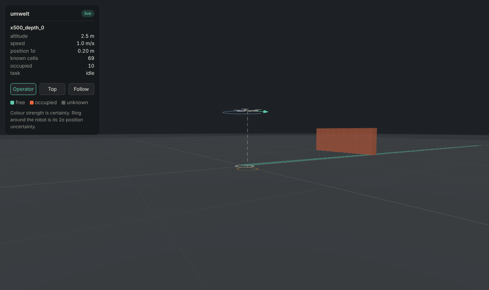

# viewer

A browser viewer that draws each robot's belief from the operator's point of view, in the `umwelt_viewer` package. It stands in for the glasses until real hardware is involved, and it is built so the same page can later run on a headset through WebXR.



## Running

It starts with the sim by default:

```bash
ros2 launch umwelt_sim sim.launch.py
```

Then open http://127.0.0.1:8765/ in a browser. To run it on its own against any robot publishing a `Belief`:

```bash
ros2 run umwelt_viewer viewer_bridge --ros-args -p robot_ids:="['x500_depth_0']"
```

## What it shows

Only what the robots believe. There is no simulator ground truth in the scene, so what you see is what a person wearing the glasses would see.

- **Belief layer** on the ground. Green is free, orange is occupied, a faint grey wash is unknown. Colour strength is certainty, `|p - 0.5| * 2`.
- **Columns** on cells with P(occupied) above 0.7, taller when more certain.
- **The robot** with its heading arrow, a dashed line to the ground and its flight trail.
- **An orange ring** on the ground: the 2-sigma horizontal position uncertainty from PX4's estimate.

Views: **Operator** (O) puts the camera at eye height beside the field, **Top** (T) looks straight down, **Follow** (F) tracks the robot.

## How it works

`viewer_bridge` subscribes to `/umwelt/<robot_id>/belief` and serves the page plus a websocket on one port. ROS spins in a background thread; the web server runs on asyncio and sends:

- **state** as JSON at up to 10 Hz: pose, velocity, position covariance.
- **grid** as a binary frame at up to 2 Hz: P(occupied) quantised to one byte per cell. A 200 x 200 grid is 40 kB, small enough for Wi-Fi to a headset.

Messages are only sent when something changed. The format is in `umwelt_viewer/protocol.py`.

| Parameter | Default | Meaning |
| --- | --- | --- |
| `robot_ids` | `['x500_depth_0']` | Robots to subscribe to |
| `host` | `127.0.0.1` | Bind address. Use `0.0.0.0` to reach it from another device |
| `port` | `8765` | HTTP and websocket port |
| `state_rate` / `grid_rate` | `10.0` / `2.0` | Maximum send rates in Hz |
| `operator_position` | `[-6.0, -10.0, 1.7]` | Operator eye position in the world frame, metres |

three.js r170 is vendored under `web/vendor/three` (MIT) so the viewer works on a local network with no internet access.
